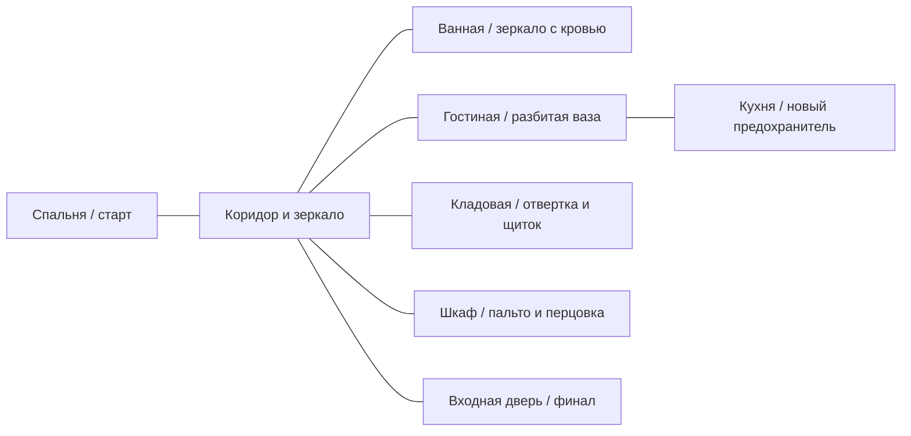

# Глава 1. Сцена 1 — «Тёмная квартира»: план реализации

Статус: согласованный план; 31.10.2026 реализована первая играбельная версия сцены. Фактический состав, параметры, проверки и границы версии — [CHAPTER_1_IMPLEMENTATION.md](CHAPTER_1_IMPLEMENTATION.md). Первая глава — начало одной игры в существующем проекте; разработка идёт поэтапно. Конкретные параметры баланса уточняются плейтестом.

## 1. Цель и тон

Игрок просыпается в чужой на вид квартире, исследует её, собирает противоречивые свидетельства, пытается восстановить свет и принимает решение, доверять ли дневнику. Кульминация: ложная угроза с пальто, затем реальный незнакомец у двери. Концовка сцены определяется действиями: обезвредить, убить или незаметно уйти.

Жанр — психологический нуар с ненадёжным восприятием. **Настоящая развязка в самом конце игры:** всё происходящее окажется затянувшейся неудачной шуткой друзей на день рождения Даши. В первой главе персонаж и игрок ещё не знают правду. Пальто раскрывается сразу, а вошедший после него человек реален, не вооружён и пока остаётся неизвестным. Летальный исход возможен: розыгрыш может закончиться трагедией. Галлюцинации не должны скрывать возможность спастись.

Целевой первый проход: 25–40 минут; повторный — 12–20. Это ориентир для проверки темпа, а не ограничение таймером. Можно спокойно читать, изучать помещения и вернуться к заметкам. У первой версии нет боевого таймера до появления реального противника.

## 2. Что есть и что меняется относительно технодемо

| Система | Есть сейчас | Работа для главы |
|---|---|---|
| Пространство | `scenes/main.tscn`: одна основная комната, коридор и тёмная кладовая | Новая квартира с несколькими связанными помещениями, дверями, камерой, коллизиями и маршрутами противника. Демо было нужно для проверки механик; отдельная демо-сцена в готовой игре не требуется. |
| Телефон | Стационарный звонок в `quest_item.gd` открывает дверь; обучение поднимает стресс до 100 | Вместо него — разряженный мобильный телефон со слабым кратковременным свечением. После ремонта электричества его можно зарядить и прочитать сохранённые сообщения и заметки о вчерашнем вечере. Связи нет, звонок невозможен, телефон не открывает дверь. Старый звонок не запускать. |
| Свет | Фонарик, тени, отдельные каналы пола/стен/персонажа, темнота и стресс | Фонарик сначала предмет, затем доступен как инструмент; уличный свет, телефон и аварийные источники работают до щитка; после ремонта включаются комнатные светильники. Сохранить непроницаемость света через стены. |
| Инвентарь | `InventoryManager`, количества и использование таблеток | Идентификаторы, предметы с состоянием, контекстное применение, экипировка и расход заряда перцовки. Не смешивать физические предметы и документы. |
| Улики | `ClueManager`, досье и доска дедукций | Добавить записи главы с постоянными ID. Полноэкранное чтение и библиотека документов — отдельный слой поверх существующего досье, с независимой локализацией и сохранением прочитанного. |
| Состояние | JSON v2, позиция, телефон/дверь, фонарик, таблетки, улики | Версионированное состояние сцены: двери, предметы, щиток, выбор, встреча, документы и контрольные точки. Существующие v1/v2 не повреждать. |
| Персонаж | 8 направлений, ускорение, фактическая дистанция шагов | Новые состояния управления, взаимодействие с ближайшим объектом, бросок, скрытность, временная потеря управления и переход в боевой режим. |
| Противник | Нет полноценного AI | Навигация, восприятие, поиск, оглушение, захват, поражение и исходы. Не выдавать существующие эффекты паранойи за готовую боевую систему. |

## 3. География квартиры

Одна непрерывная сцена из отдельных комнат-модулей. Игрок и противник перемещаются без загрузки между помещениями; дверь входа — отдельная управляемая граница. Размеры ниже ориентировочные в игровых единицах и уточняются после проверки камеры и коллизий. Масштаб объектов сохраняет возможность пройти узкие места кругом игрока радиусом 12 с запасом.



| Помещение | Назначение, ключевые объекты | Свет и маршруты |
|---|---|---|
| Спальня | Старт, кровать с таблетками, разряженный телефон, фонарик, первая записка | Слабый уличный свет сквозь шторы. Два визуальных ориентира: телефон и окно. Проход в коридор не закрыт. |
| Коридор | Зеркало «СРОЧНО УХОДИ», входная дверь, шкаф, связующие проходы | Узкое место и будущая арена ложного испуга. В начале возможен круговой обход через гостиную/кухню — не делать коридор единственной ловушкой. |
| Ванная | Зеркало с надписью кровью «Не выходи.», записка и безопасная точка наблюдения | Тёмный вход читается фонариком; игрок не обязан войти ради прохождения. Кровь подаётся как восприятие Даши, позже можно оставить доказательство неоднозначности. |
| Гостиная | Разбитая ваза, ключ от шкафа под осколками, дневник, предмет для отвлечения | Хорошая видимость площади; второй путь через кухню. Осколки читаемы без света в щитке. |
| Кухня | Новый предохранитель в доступном ящике; предметы окружения | Подсветка улицы через стекло; место для обхода противника. Предохранитель не прятать за шкафом с перцовкой. |
| Кладовая | Отвертка в ящике, электрощиток | Инструмент и щиток различимы по силуэту. Дверь кладовой не требует предохранителя. |
| Шкаф в коридоре | Заперт ключом из-под вазы; внутри перцовый баллончик и пальто на вешалке | Для ложного нападения пальто должно оставаться внутри или рядом и сработать в обеих ветках, включая уже открытый шкаф. Открытый шкаф может быть укрытием только после разрешения ложного испуга. |
| Вход | Запертая дверь с возможностью вставить ключ | Понятная зона взаимодействия, позиция появления противника снаружи и проверяемый свободный путь к выходу. |

**Рабочее размещение ключа от входной двери:** в спальне, в кармане пальто Даши у кровати. Он отличается названием и иконкой от маленького ключа шкафа. Размещать так, чтобы персонаж не мог уйти, не заметив его: объект подсвечивается при подходе, а дверь при отсутствии ключа даёт ясную подсказку. Это предложение, а не установленный канон.

Планировать не менее двух связных путей между гостиной и коридором: спальня → коридор → гостиная и гостиная → кухня → коридор. Двери внутренних комнат открыты изначально; запираются только явно заявленные входная дверь и шкаф. Ширина проходов не менее трёх диаметров коллизии персонажа; для AI — отдельная проверка NavigationRegion и безопасного обхода мебели.

## 4. Последовательность и условия перехода

1. **Пробуждение.** Даша в спальне, основной свет выключен. Короткое обучение движению и взаимодействию показывает действующие клавиши. Осмотр телефона: экран на мгновение загорается, батарея пуста, звонок недоступен. При необходимости экран — локальный слабый свет; отключается таймером и не заменяет фонарик.
2. **Первое искажение и обязательное обучение таблеткам.** Почти сразу после пробуждения Даше мерещится опасная фигура или иное тревожное изменение знакомого объекта; при повторном взгляде оно возвращается в обычное состояние. Обучение объясняет, что шкала СТРЕСС отражает тревогу, усиливающую искажения, и сама она не снижается. Игроку дают явную цель обыскать кровать, найти блистер ровно с двумя таблетками, подобрать его, открыть инвентарь и обязательно принять одну дозу. До применения заблокировать только продвижение за пределы вводного участка, а не взаимодействие с кроватью и инвентарём; после приёма снять блокировку и оставить одну дозу. Одинаково работает при переназначенных клавишах, повторе и загрузке. Старый принудительный звонок не используется.
3. **Начальное исследование.** Игрок находит входной ключ и фонарик, осматривает записку. Фонарик становится доступен после подбора; до этого его нельзя включить горячей клавишей. Темнота постепенно усиливает стресс; свет останавливает соответствующий прирост, но не уменьшает шкалу.
4. **Квартира открывается для исследования.** Ваза, шкаф, оба зеркала, дневник, отвёртка и предохранитель доступны в разных комнатах. Порядок свободный: сначала перцовка или дневник, сначала один элемент щитка или другой. Найденные предметы не исчезают при переходе между комнатами.
5. **Дневник и выбор.** При первом завершённом чтении дневника игрок выбирает «Поверить» или «Это шутка». Для выхода нужен один из ответов; решение сохраняется сразу. Если баллончик уже найден, ветка доверия отмечает готовность к защите, а не создаёт повторное задание. Если найден позже — цель защиты закрывается при подборе. Игнорирование не запрещает подобрать баллончик позднее.
6. **Выбор освещения и телефона.** Игрок может найти фонарик и исследовать квартиру с ним, починить свет для более комфортного поиска, либо совместить оба способа. После ремонта появляется возможность зарядить найденный телефон. Ни ремонт, ни зарядка не обязательны для выхода; отсутствие фонарика само по себе также не должно блокировать прохождение при включённом свете. С отвёрткой и предохранителем игрок открывает крышку и замыкает щиток.
7. **Попытка выхода.** Если нет входного ключа или выбора дневника, дверь сообщает конкретную причину и не запускает встречу. При выполнении условий первое взаимодействие вызывает падение пальто/QTE независимо от состояния освещения, перцовки и шкафа.
8. **После ложного испуга.** Пальто и вешалка явно раскрываются в кадре; Даша получает короткую реплику. Можно восстановить управление и использовать доступные предметы. Автосохранение после завершённого QTE.
9. **Реальный противник.** Следующее подтверждённое взаимодействие вставляет входной ключ; ручку дёргают снаружи, появляется реальный человек. Дверь не требует повторного ключа при последующих подходах. Запускается единая встреча с несколькими решениями.
10. **Исход и переход.** Обезвреживание, гибель противника или тихий выход фиксируют разные флаги. Когда выход подтверждён, сцена завершается контролируемым переходом на заглушку следующей сцены с сохранением исхода. Не выдумывать продолжение сюжета как завершённый контент.

У двери нужен контекстный текст для каждого блокера: «Нужен ключ от входной двери», «Сначала стоит дочитать дневник», затем «Открыть дверь». Если блокеров несколько, отображать ближайший понятный и поддерживать обновление при изменении состояния. Механика не должна требовать света или необязательного баллончика.

## 5. Исследование и предметы

| ID | Где и как получить | Использование и ограничения |
|---|---|---|
| `apartment_key` | Осмотреть пальто Даши возле кровати | Не расходуется при вставке; флаг `key_inserted` отделён от наличия предмета. |
| `flashlight` | На тумбочке в спальне | Подбор открывает действие фонарика. Источник света не проходит сквозь стены. Батарейку не вводить без отдельного решения. |
| `phone_dead` | Тумбочка в спальне | Экран вспыхивает на 1–2 секунды при осмотре. После восстановления питания телефон можно подключить к зарядке и читать сохранённые сообщения и заметки о вчерашнем вечере. Связи нет и после зарядки; вызовы и отправка сообщений недоступны. Состояние заряда — свойство одного телефона, а не дублирующий предмет. |
| `phone_charger` | Рабочее предложение: на тумбочке рядом с телефоном | Зарядить телефон можно только при включённом электричестве. Если зарядка выделяется предметом, она не расходуется; расположение и окончательный способ взаимодействия уточнить при сером прототипе. |
| `pills` | Обыск кровати во вводном обучении | В стартовом блистере ровно две таблетки. Одну игрок обязательно применяет через инвентарь в начале игры; вторая сохраняется для дальнейшего прохождения. Доза снимает 40 пунктов; повторно не появляется. Не требовать достижения тревоги 100 для доступа к блистеру. |
| `cupboard_key` | Под осколками в гостиной | Осмотр вазы → безопасно отодвинуть осколки → забрать ключ. Обе стадии имеют подсказку. Ключ используется только у шкафа. |
| `pepper_spray` | Открыть шкаф ключом | Необязательный защитный предмет. Одна доза для первого прототипа; расходовать только при успешном применении в пределах дистанции и видимости. |
| `screwdriver` | Выдвижной ящик кладовой | Постоянный инструмент; нужен для крышки щитка, не расходуется. Возможность использовать в бою в первой версии исключить, чтобы сохранить читаемость исходов. |
| `fuse` | Кухонный ящик | Используется в открытом щитке; после установки удаляется из инвентаря, флаг `fuse_installed` сохраняется. |
| `throwable_vase` | Целая небольшая ваза в гостиной/кухне | Отдельный объект от уже разбитой вазы с ключом. Можно поднять и бросить только в фазе реальной встречи; расходуется при броске, отвлекает шумом. |

Осколки под ключом не делают предмет непроходимым: взаимодействие с `BrokenVase` состоит из `UNEXAMINED → SHARDS_MOVED → KEY_TAKEN`. Пока идёт анимация/диалог, повторный ввод игнорируется. Коллизия пола не создаёт невидимой преграды; урон от стекла в первом варианте не добавлять. Ключ, шкаф и баллончик должны иметь непересекающиеся ID и UI-подписи.

Взаимодействие: один `InteractionController` выбирает ближайший доступный объект в радиусе с приоритетом текущего фокуса; `E`/переназначенное действие запускает только его. Триггеры самостоятельных объектов не должны одновременно потреблять один ввод. Если открыт диалог, документ, инвентарь или QTE, обычный мир не получает действие. UI закрывается по `ui_cancel`; подсказки показывают текущие привязки `SettingsManager`.

## 6. Записки, дневник и противоречия

Документ — запись данных, а не предмет с количеством. При первом осмотре открыть читабельную панель на весь экран: текст поверх фактуры бумаги, название, обозначение страницы, кнопки «Закрыть» и «В дневник». Запись добавляется в библиотеку при открытии независимо от того, дочитал игрок текст или закрыл панель; отдельный флаг прочтения фиксировать только при завершении. Повторное взаимодействие не создаёт дубликат.

Доступ из паузы и назначаемой горячей клавиши: вкладка **«Дневник»** в существующем досье, список найденных документов и повторное полноэкранное чтение. Открытие/закрытие сохраняет ранее активную вкладку; текст масштабируется, скролл работает мышью и клавиатурой, длинный контент не обрезается на 1280×720 и при изменении разрешения. Во время QTE/катсцены открытие запрещено с короткой подсказкой; в реальном столкновении мир на паузу ради чтения не останавливается — документ открыть нельзя. В свободном исследовании чтение ставит мир на паузу и затем восстанавливает исходное состояние паузы/управления.

| Документ | Размещение | Роль | Обязательность |
|---|---|---|---|
| `note_bedside` | Спальня | Рукописное «Проверь замок. Не доверяй тому, что видишь». Обучение чтению. | Необязательно |
| `note_fuse` | Рядом со щитком | Схема: отвёртка открывает крышку, новый предохранитель заменяет повреждённый. | Необязательно; те же требования видны при взаимодействии |
| `diary_stalking` | Гостиная, доступен без предметов | Несколько датированных записей о слежке, страхе и сомнениях в собственных воспоминаниях. После завершения чтения выбор доверия. | Обязательно для выхода |
| `note_bath` | Ванная | Контекст к «Не выходи.» без объяснения автора. | Необязательно |
| `note_hall` | Коридор | Контекст к «СРОЧНО УХОДИ», противоречащий ванной. | Необязательно |
| `phone_messages_yesterday` | Локальная история сообщений на заряженном телефоне | Фрагменты переписки помогают восстановить события вчерашнего вечера; показывать без подключения к сети и сохранять в дневник как прочитанные документы. | Необязательно |
| `phone_notes_yesterday` | Локальные заметки на заряженном телефоне | Заметки Даши и краткие напоминания о вчерашнем; не раскрывают финал заранее. | Необязательно |

Черновик дневника: «Понедельник. Машина стояла у подъезда весь вечер. Когда я вышла — её уже не было»; «Среда. Я слышала шаги за дверью. Сосед говорит, что никого не видел»; «Сегодня. Если я снова скажу себе, что это шутка, проверь замок ещё раз». Тексты — редактируемые заготовки, не окончательный канон.

Выбор после дневника:

- **Поверить:** `diary_choice = TRUST`; если перцовки нет — необязательная цель «Найти средство защиты» с подсказкой о запертом шкафе. Если есть — «Средство защиты найдено». Выбор повышает устойчивое доверие к угрожающей интерпретации и влияет на последующие искажения через систему паранойи.
- **Шутка:** `diary_choice = DISMISS`; Даша рационализирует записи. Цель защиты не показывается, доступ к шкафу и варианты защиты сохраняются. Реальный противник появляется по тем же правилам.
- Выбор не переигрывается повторным чтением. Чем больше Даша доверяет пугающим свидетельствам и собственным подозрениям в последующих сценах, тем сильнее искажаются окружение и её интерпретации. Этот накопленный фактор переносится в дальнейшие части игры; он связан со шкалой тревоги, но не должен каждый кадр бесконечно повышать её одним и тем же событием.

## 7. Щиток и освещение

1. Первое взаимодействие: «Крышка закреплена винтами; нужен инструмент»; подсветить состояние, а не местоположение инструмента через стену.
2. При наличии отвёртки открыть крышку отдельным действием. Отвёртка остаётся в инвентаре. Доступный повреждённый предохранитель виден в панели.
3. Без нового элемента: «Предохранитель перегорел. Найдите замену». При наличии — установить замену, убрать одну единицу и записать `fuse_installed`.
4. Отдельное действие «Включить автомат» активирует комнаты, меняет звуковую среду и сохраняет `power_on`. Повторное взаимодействие сообщает состояние; бесконечное дублирование предметов невозможно.
5. До включения лампы не освещают комнату; уличный свет и ограниченный экран телефона остаются. Фонарик и свет дают тени, но не проходят за закрытые двери/стены. Включение света не отменяет реального противника и не обнуляет тревогу мгновенно.
6. После `power_on` взаимодействие с зарядкой позволяет подключить найденный телефон; до ремонта показывать «Нет электричества — зарядить телефон не получится». Фиксировать `phone_charging` и `phone_charged`. После зарядки доступны локально сохранённые сообщения и заметки о событиях вчерашнего вечера, даже при отсутствии сети; звонить и отправлять сообщения нельзя. Длительность зарядки — настраиваемая рабочая величина. Найденные сообщения можно повторно открыть в дневнике. Зарядка не блокирует выход и не создаёт циклическую зависимость от необязательных предметов.

Использовать существующую систему каналов света и слои 1/2/4/8 только с документированным расширением для новых комнат. Для выключения/включения хранить групповые состояния комнатных ламп и индивидуальное состояние двери/окклюдера; не клонировать жёстко координаты `room_lighting.gd` из демо. Передние стены плавно скрываются рядом с персонажем, а AI, предметы и подсказки не пропадают при пересечении. Проверить отсутствие засвета между комнатами и направление фонарика на вертикальных стенах.

## 8. Тревога и обучение

Шкала СТРЕСС/пульс остаётся видимой; она описывает восприятие, а не здоровье. Темнота повышает тревогу после 1,5 с по текущей базовой настройке, фонарик останавливает страх темноты, но не мгновенно снимает накопленное. Восстановление и таблетки брать из `ParanoiaManager`/`InventoryManager`; окончательный баланс проверить на новой площади, а не предполагать, что демо-параметры идеальны.

**Правило ресурса:** в начале всей игры доступны ровно две таблетки, первая обязательно применяется в обучении, вторая остаётся игроку. Дополнительные источники таблеток и способы снижения тревоги пока не вводятся; автор определит их позже. Каждый блистер имеет постоянный ID и подбирается единожды, автоматического пополнения между сценами нет. Тревога сама по себе **не снижается**: фонарик и безопасная среда останавливают соответствующий рост, но не уменьшают накопленное значение. Существующее в технодемо пассивное затухание необходимо отключить для новой игры. Уровни и темп прироста можно настраивать и плейтестировать без пересмотра этого правила.

**Доверие и восприятие:** предложить сохраняемый параметр `belief` для накопленной убеждённости и текущий `stress` для непосредственного состояния. Выбор дневника прибавляет доверие один раз; последующие подтверждённые сюжетные решения могут его повышать. Повторное чтение и загрузка не дают повторной прибавки. Текущая сила искажений вычисляется из обоих значений по ограниченной формуле в балансировочном ресурсе; доверие может усиливать реакцию на новые угрозы, но не создаёт бесконечного непрерывного прироста стресса без события. Таблетки снижают текущий стресс, не стирая сделанный сюжетный выбор. Точные коэффициенты и исходное значение — рабочие параметры для утверждения после тестов.

Проверять три диапазона восприятия: низкий — обычные звуки и нейтральные реплики; средний — настораживающие интерпретации и лёгкие визуальные искажения; высокий — более выраженные параноидальные мысли и изменения окружения. Отличия должны быть заметны на одинаковых событиях при разном доверии и не скрывать доступные действия, реальные коллизии или выход. Не показывать окончательную правду о празднике до предусмотренного раскрытия.

В новой сцене:

1. Почти сразу показать первое искажение, после чего объяснить название шкалы и связь тревоги с восприятием. Обучение не обязано доводить шкалу до 100, но должно наглядно показать изменение.
2. Дать обязательную цель «Обыскать кровать: там успокоительные». До завершения урока ограничить выход из стартового участка; целевая кровать и инвентарь остаются доступными.
3. Игрок находит блистер из двух таблеток, подбирает его, открывает инвентарь назначенной клавишей и применяет одну через кнопку «Принять». Одно использование — минус 40 пунктов; остаётся ровно одна доза. Только успешное использование разблокирует дальнейшее исследование.
4. При входе в тьму объяснить назначаемую кнопку фонарика только после его подбора. До подбора не требовать невозможного действия; спальня остаётся читаемой от уличного света.
5. Эффекты паники ограничены: вибрация не закрывает QTE, инструкции и жизненно важные объекты; снижать интенсивность/отключать в настройках. Текущая паника не меняет истинные состояния замков или исхода боя.

## 9. Ложный босс: пальто

**Триггер:** входной ключ в инвентаре, выбор дневника сделан, фаза `FALSE_SHADOW_NOT_SEEN`, игрок взаимодействует с входной дверью. Состояние шкафа, наличие перцовки и питание на триггер не влияют. До триггера разблокировать проход к двери и убедиться, что контрольная точка сохраняема.

**Постановка:** дверь слегка подаётся, в шкафу раздаётся треск, падающая вешалка и тень перекрывают часть кадра; Даша оказывается на полу. Камера и звук усиливают искажение, но UI объясняет: «Освободитесь: быстро нажимайте отображаемые клавиши». Пользователь управляет только QTE, пауза работает корректно, фоновые действия и AI ещё не активны.

**QTE, рабочий баланс:** 8–12 подтверждённых нажатий за 8 секунд; последовательность состоит из двух назначаемых действий, показывается текущий и следующий ввод. Учёт только `just_pressed`, запрет удержания/автоповтора, без жёсткой привязки к WASD и без зависимости от FPS. При ошибке прогресс не обнуляется; игрок получает звук и небольшую задержку. Время и число нажатий вынести в ресурсы настроек сложности.

**Неуспех:** отсутствие ввода за 8 секунд приводит к повторной попытке с короткой репликой и сохранением не менее половины прогресса; не убивать игрока за пальто и не запускать реального врага до разрешения сцены. В настройках доступен альтернативный режим удержания одной клавиши или автоматического завершения с задержкой, а также увеличенное время. Избежать обязательного быстрого чередования для людей, которым оно недоступно.

**Развязка:** камера показывает пальто, вешалку и свободные руки Даши; звук искажений постепенно возвращается к норме. Проставить `false_shadow_resolved`, закрыть QTE, восстановить прежнюю камеру, ввод, время и звук, затем записать автосохранение. Повторное взаимодействие с дверью запускает только реальную встречу.

## 10. Реальный противник: правила и исходы

**Состояния встречи:** `DORMANT → ENTRY → SEARCH/CHASE → STUNNED/RESTRAINED/DEAD → ESCAPED или PLAYER_CAUGHT`. Появляется только после повторного действия у двери, на заранее проверенной свободной позиции за входом. Передавать управление после короткой постановки; противник не наносит удар в первые 2 секунды, игрок видит направление угрозы. При повторной загрузке постановка не создаёт второго врага.

Реальный противник **не вооружён**; за сценой стоит неудавшийся розыгрыш друзей, однако Даша этого ещё не знает. Его личность и точные действия для сохранения интриги требуется определить отдельно. Смертельный исход доступен и становится значимым трагическим последствием, а не обнуляется комедийным раскрытием.

**Восприятие:** ограниченный сектор зрения и дистанция, препятствия проверяются физическим лучом; темнота/свет влияют на дальность обнаружения, но не превращают Дашу в невидимку в освещённом луче. Звук броска имеет позицию, радиус и длительность; враг идёт к последнему источнику, затем ищет, не телепортируется и не узнаёт позицию игрока сквозь стены. Обход мебели по навигации; навигационные препятствия и проёмы соответствуют коллизиям. Все расстояния, задержки и длительности — настраиваемые данные для плейтеста, не константы UX.

**Инструменты игрока:**

| Действие | Условие | Эффект и ограничения |
|---|---|---|
| Бросить целую вазу | Предмет подобран, доступная точка броска | По дуге/упрощённой траектории приземляется, разбивается, расходуется, создаёт локальный шум; враг расследует. Ключевая разбитая ваза не расходуется повторно. |
| Ослепить фонариком | Фонарик найден и включён; луч направлен в лицо с дистанции и прямой видимостью в течение короткого времени | Краткое ослепление с охлаждением; не действует через стены, в спину или в момент неуязвимости. Понятный визуальный/звуковой сигнал успеха. |
| Перцовый баллончик | Предмет найден, есть заряд; цель перед игроком и в пределах действия | Расходует один заряд при успешном применении; оглушает достаточно долго для ухода или обезвреживания. Промах должен быть ясно показан; правило расхода при промахе зафиксировать в настройках прототипа и подсказке. |
| Спрятаться | Свободное укрытие, враг не видит вход прямо сейчас | Персонаж недоступен для обычных взаимодействий, может покинуть укрытие; близкий враг способен проверить последнее известное место. Открытое меню не является укрытием. |
| Обезвредить | Враг оглушён; игрок рядом и активирует контекстное действие | Нелетальный исход, враг больше не преследует; быстрые нажатия не обязательны. |
| Смертельное действие | Явно обозначенный опасный вариант при подходящей ситуации | Отдельное удержание с понятной подписью и возможностью отмены до завершения. Фиксировать только после завершения; не подменять им случайный бросок/ослепление. Детали оружия и постановки требуют утверждения до производства. |
| Тихо уйти | Вход открыт после появления врага; путь свободен и игрок вне захвата | Зафиксировать `escape_mode = stealth`, когда враг не преследует и не видит игрока в момент пересечения порога. В ином случае — не называть уход тихим; допустим отдельный флаг `escape_mode = pursued`. |

Ключевое решение игровой логики: **все три исхода достижимы без необязательной перцовки**. Фонарик помогает, если найден, но выход и защита также должны работать без него: целая ваза и безопасно читаемые объекты окружения дают альтернативное окно отвлечения и обезвреживания. Летальный исход утверждён; конкретный интерактивный объект, анимация и степень натуралистичности остаются задачей постановки. Предусмотреть явное подтверждаемое действие и сохранить факт произошедшего до раскрытия розыгрыша. Ни один обязательный для выхода предмет не расходуется в бою.

### Последствия действий до финала и перенос во вторую часть

Вести историю подтверждённых сюжетных последствий, а не сводить всё к одному необратимому числу. Как минимум записывать стабильные ID встречи/персонажа, исход (`killed`, `neutralized`, `escaped`), факт намеренного летального действия и версию правил. Повторная загрузка, повторное получение сигнала и откат к контрольной точке не добавляют события повторно. Поражение и неудачная попытка откатывают все их последствия вместе с остальным состоянием.

Из событий можно вычислять показатель последствий, аналогичный по роли уровню хаоса: летальный исход и нелетальные решения различаются; конкретные веса, пороги и реакции мира пока не утверждены. Сюжетные последствия должны накапливаться на протяжении игры и влиять на финальное раскрытие розыгрыша; смерть нельзя отменить самим раскрытием. Перенос во вторую часть — версионированный итоговый профиль с перечнем существенных событий и вычисляемым показателем. Формат импорта, платформа, идентификация сохранения и конкретные изменения второй части — отдельная задача будущего этапа. Не заявлять, что перенос уже реализован.

**Поражение/повтор:** при захвате реальным противником — экран поражения с «Повторить встречу» и «В главное меню». Контрольная точка перед реальным появлением восстанавливает здоровье/тревогу, заряды, положение вазы, освещение и выбор строго как до начала встречи; без копирования предметов. Пауза не продвигает AI, таймеры и QTE. Автосейв во время боевого перехода не должен сохранять половину операции.

## 11. Состояния, сохранения и миграция

Предлагаемое состояние `chapter_1.apartment` — единый источник истины; конкретные названия формата могут уточняться при проектировании:

```json
{
  "chapter": 1,
  "scene_id": "apartment",
  "phase": "exploration",
  "diary_choice": "unselected",
  "belief": 0.0,
  "consequences": {"lethal_count": 0, "nonlethal_count": 0, "outcomes": [], "score_version": 1},
  "documents_found": ["note_bedside"],
  "documents_read": [],
  "world": {"shards_moved": false, "cupboard_open": false, "fuse_panel_open": false, "fuse_installed": false, "power_on": false, "phone_charging": false, "phone_charged": false, "key_inserted": false, "false_shadow_resolved": false, "vase_thrown": false},
  "encounter": {"state": "dormant", "outcome": "none", "escape_mode": "none"},
  "tutorial": {"movement": false, "stress": false, "inventory": false},
  "checkpoint_id": "apartment_start"
}
```

Инвентарь, улики, стресс и позицию не дублировать в нескольких взаимоисключающих источниках: сохранить их в соответствующих менеджерах, а привязанные к сцене события — в `chapter_1`. Данные ресурсов и позиции объектов описывать стабильными ID, не `NodePath` как ключом сохранения. Главы развиваются внутри одного проекта и одной версии игры. Совместимость и сюжетная миграция v1/v2 не требуются: отладочное прохождение начинает новую главу с нового состояния. Старые файлы не удалять автоматически; несовместимые слоты корректно помечать. Отдельный режим старого демо не требуется.

Переходы и операции: проверка условий → единое изменение состояния → обновление мира → сигнал/UI → сохранение в контрольной точке. Восстановление сначала закрывает активные модальные окна и блокирует ввод, валидирует данные, применяет состояние предметов/дверей/света и позицию, затем запускает сигналы и AI. Не открывать документы и не воспроизводить награды повторно при загрузке. Сохранения из новой сцены не должны зависеть от конкретных путей `Pills`, `Player/Flashlight` и однокомнатной сцены.

Контрольные точки: старт; завершённый выбор дневника; завершение ремонта (если выполнен); завершение ложного босса; непосредственно перед реальной встречей; завершение сцены. Обычное сохранение разрешено в свободном исследовании. Во время катсцены, QTE, анимации замены предохранителя и боя — понятный отказ или запись последней стабильной точки; не делать сохранение неявно успешным. Быстрая загрузка закрывает все модальные окна и восстанавливает управление.

## 12. Предлагаемая архитектура Godot

```text
scenes/chapter_1/apartment.tscn     # корень, камеры, общая навигация и контроллер
scenes/chapter_1/rooms/*.tscn      # спальня, коридор, ванная, гостиная, кухня, кладовая
scenes/chapter_1/objects/*.tscn    # дверь, шкаф, щиток, ваза, записка, укрытие
scenes/chapter_1/enemy/shadow.tscn # реальный противник
scenes/ui/document_reader.tscn     # полноэкранное чтение / страницы
scenes/ui/qte.tscn                 # доступный ввод и обратная связь
scripts/chapter_1/apartment_controller.gd
scripts/chapter_1/chapter_state.gd
scripts/interactions/interaction_controller.gd
scripts/enemies/shadow_controller.gd
resources/chapter_1/documents/*.tres
resources/chapter_1/items/*.tres
resources/chapter_1/balance.tres
```

Пути — предложение, а не утверждение о существующих файлах. `ApartmentController` управляет переходами фаз, условиями и контрольными точками, не хранит логику каждой двери. `ChapterState` предоставляет типизированные методы и сигналы изменений, сериализацию и проверку допустимых переходов. Объекты реализуют общий контракт `can_interact(context)`, `get_prompt(context)`, `interact(context)` и сигнал результата. Полноэкранный читатель получает ресурс документа и возвращает событие завершения/отмены; выбор дневника открывается только после завершения чтения.

AI разнести на навигацию, сенсоры и FSM: `IDLE`, `INVESTIGATE`, `SEARCH`, `CHASE`, `STUNNED`, `RESTRAINED`, `DEAD`; переходы имеют явные причины и максимальные таймауты. QTE — собственная UI-сцена, не привязанная к рендерному FPS; события ввода и игровые часы инъецируются/контролируются для тестов. Свет и камеры — отдельные компоненты комнат; звуки используют `SoundManager` и аудиошины, не создают неограниченные плееры.

Не создавать новый глобальный singleton без нужды. Использовать существующие autoload для инвентаря, настроек, аудио и стресса; `ClueManager` расширить данными, а не копировать. Данные главы принадлежат сцене и сериализуются через `SaveManager`. Управление игроком: централизованные причины блокировки или токены, чтобы закрытие инвентаря не снимало блокировку QTE/диалога. Все соединения сигналов должны отключаться при выгрузке сцены; переходы — идемпотентны.

## 13. Сценарный и визуальный контент

Нужно подготовить: план квартиры и коллизий; изображения комнат и изометрических стен; непротиворечивые силуэты выключателей, двери и шкафов; предметы и пиктограммы; портреты/анимации Даши и противника; отдельную читаемую вешалку/пальто; страницы записок и текстовую транскрипцию; эффекты фонарика и света; набор Foley для шагов, ящиков, вазы, ключей, щитка, ткани, перцовки и попадания; эмбиент до/после света и боевую динамику.

Производство выполняется с помощью GPT; целевая детализация — средняя, язык только русский, озвучки пока нет. Все игровые объекты и интерактивные состояния должны существовать и быть читаемыми уже в первой реализации. Текстуры и окончательная художественная отделка могут быть заменены автором позднее; предусмотреть заменяемые ресурсы без переписывания логики. Модели и кадры технодемо допускаются как временные заглушки, но не заменяют отсутствующие объекты. Документы должны быть доступны без распознавания декоративного почерка. Звуковые эффекты диалогов и подсказок сохраняют текущую мягкую громкость и ограничение повторов; для новых эффектов проверить пики, уровни и субъективное звучание. Тексты и названия предметов организовать так, чтобы можно было изменить язык позднее; не зашивать `[E]` и `[I]`.

## 14. Этапы реализации и результаты

1. **Вертикальный срез и оставшиеся детали.** Решения автора о телефоне, электричестве, развязке, невооружённом противнике, летальном исходе, ресурсах, камере и едином проекте приняты. Уточнить только ещё не определённые детали из раздела 16; прототипировать один замкнутый путь без создания отдельного режима демо.
2. **Серая квартира.** Сцены помещений, переходы, единая камера и проходы; расстановка трёх условных источников света. Результат — проходимая без тупиков карта, замеры маршрутов и проверка на разных разрешениях.
3. **Состояние и взаимодействия.** Единый выбор цели, ID, локальные флаги, переносимые между главами тревога/доверие/остаток предметов и схема сохранений. Новая схема без обязательной совместимости со старыми v1/v2; отладочная маркировка несовместимых слотов. Результат — предметы, дверь и шкаф работают после перезагрузки; старые файлы целы.
4. **Исследование и документы.** Телефон, фонарик, ключи, таблетки, обе надписи, ваза и полноэкранные записи/дневник. Результат — поиск и чтение без дубликатов, кнопки/горячие клавиши соответствуют настройкам.
5. **Щиток и телефон.** Оба инструмента и фазы ремонта, работа источников света и тени, зарядка телефона при наличии электричества. Результат — маршруты с ремонтом/без него, с найденным фонариком или с освещённой квартирой; зарядка не блокирует финал.
6. **Выбор и ложный босс.** Дневник, независимость от порядка получения перцовки, QTE, раскрытие пальто, контрольная точка. Результат — оба выбора и оба состояния шкафа приводят к одной корректной развязке.
7. **Реальная встреча.** Серый AI невооружённого противника, зона входа, действия фонарика/вазы/перца, укрытия, три исхода, перезапуск. Летальный путь входит в объём; конкретную постановку определить на этапе прототипа. Результат — все маршруты достижимы и различимы.
8. **Художественный проход и звук.** Детализация, анимации, читабельные документы, настройка уровней, тесты под цветовой и двигательной доступностью. Результат — визуально и акустически связная сцена.
9. **Интеграция и релизная проверка.** Тесты состояния, нагрузки, сцен, обработки несовместимых слотов, экспорта Windows и ручные прохождения; исправить блокеры и обновить документацию. Результат — воспроизводимая сборка главы, а не только лабораторный тест механик.

Параллелить внутри этапа можно только работу над независимыми ресурсами; API состояния, расположение ключевых объектов и правила исходов зафиксировать до сборки контента. Оценки сроков намеренно не задаются без состава команды и объёма ассетов.

## 15. Критерии приёмки и проверки

**Проходимость:** новая игра → ключ и исследование → дневник и любой выбор → дверь → ложная встреча → реальная встреча → один из трёх исходов. Пройти с ремонтом и без, с найденным фонариком и без него при работающем свете, с зарядкой телефона и без неё, с перцовкой до/после дневника и без неё, с обоими ответами. Проверить каждый путь минимум в двух порядках исследования. Убийство/обезвреживание/тихий уход фиксируются разными значениями, повторный триггер не создаёт второго врага.

**Предметы:** нельзя взять скрытый ключ до осмотра вазы, получить два ключа, повторить подбор, поставить предохранитель без отвёртки/детали или потратить предмет дважды. Проверить пропущенные предметы у входа, шкаф уже открыт до дневника, пустой/использованный баллончик и невозможный бросок. Для каждой операции — сохранение до/после, загрузка в текущей сцене и из меню.

**Дневник и UI:** найденные документы открываются на весь экран, сохраняются, читаются повторно, не дублируются после загрузки. Проверить закрытие на первой/последней странице, отмену выбора до подтверждения, выбор и повторное чтение, изменённые клавиши, клавиатуру/мышь, масштаб текста и экран 1280×720 плюс широкий/малый размер окна. Временная блокировка ввода и исходное состояние паузы всегда восстанавливаются.

**Свет и стены:** выключенный/включённый щиток, фонарик в четырёх направлениях у каждой стены и двери, закрытые/открытые двери, видимость персонажа за передними стенами, отсутствие ложных теневых клиньев и утечки сквозь перегородку. Телефон даёт краткий источник света, не позволяет обходить условие подбора фонарика. Отдельные кадры и видео движения, не только проверка значений узлов.

**QTE:** успех, ошибки, отсутствие ввода, повтор, пауза, переназначение, режим удержания/автопомощи, 30/60/144 FPS. На каждом выходе восстанавливаются камера, звук, управление и таймеры; автосейв после раскрытия не запускает пальто снова.

**Встреча:** зрение проверяется стенами, звук приводит к последней известной точке; поиск прекращается по таймеру; враг проходит все двери и не застревает. Фонарик не ослепляет сквозь стены; перец расходуется корректно; брошенная ваза отвлекает только в пределах слышимости. Прогнать сценарии без оружия, после отключения/включения света, с пустым зарядом и без освещённого маршрута. Проверить смерть игрока, повтор и все финальные флаги.

**Тревога и дефицит:** проверить первое видение и обязательную практику через инвентарь: при старте в блистере две таблетки, первая применяется игроком, после урока остаётся одна. В течение длительного ожидания в безопасности тревога не снижается; фонарик останавливает страх темноты без уменьшения накопленного значения. Сравнить одинаковую ситуацию при низком и высоком доверии дневнику, убедиться в различии мыслей/искажений и сохранении читаемости управления. Повторное чтение и загрузка не повышают доверие повторно; таблетки уменьшают текущий стресс, но не меняют выбор. Дозы не восполняются автоматически, найденный блистер не появляется снова, истощённый запас не блокирует прохождение. При провале встречи откат восстанавливает точно состояние контрольной точки, а при успешном переходе остаток предметов, доверие и последствия сохраняются.

**Телефон и последствия:** без электричества зарядка недоступна; с электричеством телефон заряжается, затем локальные сообщения и заметки доступны без связи и повторно читаются из дневника. Отсутствие зарядки не блокирует выход. При летальном, нелетальном и тихом исходах записываются различимые события; повтор сигналов и откат к контрольной точке не увеличивают счётчик. Итоговый профиль сохраняет версию и необходимые события для будущего импорта, даже когда вторая часть ещё не реализована.

**Надёжность:** изолированные тестовые сохранения; новые сохранения и повреждённые/частичные данные; v1/v2 корректно распознаются как несовместимые без требования миграции; выключение приложения на каждой контрольной точке; FPS и пауза; отсутствие незавершённых сигналов и дубликатов AI; замеры времени кадра/памяти в самой населённой комнате; экспорт и запуск Windows-сборки, а не только headless-импорт. В дополнение к автоматическим тестам — наблюдаемый плейтест без подсказок разработчика и исправление мест, где игрок не понимает цель.

Глава готова, когда обязательный путь и необязательные ветки пройдены без блокирующих ошибок, все три исхода доступны, старые сохранения безопасны, управление и доступность проверены, а визуальные/звуковые решения утверждены в работающей сборке.

## 16. Принятые решения и оставшиеся технические детали

Принято автором: телефон после зарядки показывает сохранённые сообщения и заметки о вчерашнем вечере; связи и звонков нет. Розыгрыш друзей на день рождения раскрывается лишь в самом конце всей игры; до этого вошедший остаётся неизвестным. Насилие и летальные исходы создают накопленные последствия по принципу уровня хаоса, которые должны пережить финал и быть переносимыми во вторую часть. Тревога сама не снижается, способов успокоения кроме таблеток пока нет. В начале игры ровно две таблетки, одну игрок обязан принять в обучении после первого пугающего видения. Озвучки пока нет, язык только русский. Старые сохранения v1/v2 не требуют совместимости; технические проверки ведутся в отладке.

Открытые рабочие параметры без необходимости останавливать прототип: время зарядки и положение зарядки, содержание конкретных сообщений, личность неизвестного, точный предмет и постановка летального исхода, коэффициенты доверия/тревоги/последствий, оформление UI переноса результата, а также детали анимаций и разрешения временных ассетов. Значения параметров определить при реализации и плейтесте; не добавлять источники таблеток или способы успокоения без решения автора.
